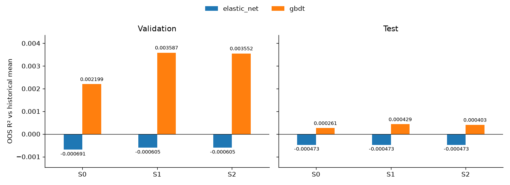

# DSA5205 Project 2: Sector Relative-Return Prediction

This project studies whether cross-sector information improves forecasts of sector ETF returns relative to SPY. It provides a complete workflow for data acquisition, cleaning, feature construction, monthly model fitting, forecast evaluation and prediction export. Elastic Net supplies a regularized linear benchmark; Gradient Boosted Decision Trees (GBDT) capture nonlinear relationships and feature interactions.

## Report artifact correspondence

These paths identify the saved experiments used in the integrated report (numerical snapshot `bc7b92f`). Fresh executions produce separate outputs under `results/reproduction/`; they do not overwrite the archived portfolio runs listed below. All paths are relative to the repository root.

| Report evidence | Saved artifacts |
|---|---|
| Source identity and data timing | `notebooks/download_manifest.json`; `notebooks/cleaning_checks/`; `notebooks/panel_checks/`; `data/processed/panel_spec.json`. |
| Elastic Net parameters and metrics | `results/elastic_net/selected_hyperparameters.csv`; `results/elastic_net/forecast_metrics.csv`; `results/elastic_net/fit_audit.csv`. |
| Elastic Net supplementary diagnostics | `results/elastic_net/exploratory_validation/`; `results/elastic_net/xlf_diagnostics/`; `results/elastic_net/loss_difference_uncertainty.csv`. |
| GBDT selection and metrics | `results/gbdt/model_config.json`; `results/gbdt/validation_grid.csv`; `results/gbdt/selected_hyperparameters.csv`; `results/gbdt/forecast_metrics.csv`; `results/gbdt/group_permutation_importance.csv`. |
| Original pair threshold and results | `results/backtest/threshold_selection/validation_candidate_scores.csv`; `results/backtest/reporting/main_metrics.csv`; `results/backtest/reporting/sensitivity_metrics.csv`. |
| Overlay comparison and final presentation | `results/backtest/spy_overlay_final_20261101/all_12_candidates_ranked.csv`; `results/backtest/spy_overlay_final_20261101/selected_and_benchmarks.csv`; `results/backtest/spy_overlay_final_20261101/selected_cost_decomposition.csv`; `results/backtest/spy_overlay_final_20261101/selection_record.json`. |

## Fresh end-to-end notebook execution (2026-11-02)

Finish notebooks **01 → 02 → 03 → 04**, then run **05 → 06** from top to bottom using the project's Python 3.12 environment. All six notebooks locate the project from the current directory or its ancestors; Jupyter can start at the project root or in `notebooks/`. Select the local environment's kernel on each computer. Wait for notebook 04 to finish exporting its files before starting 05.

On a new Windows computer, create a local environment rather than copying `.venv/`:

```powershell
py -3.12 -m venv .venv
.\.venv\Scripts\python.exe -m pip install -r requirements.txt
.\.venv\Scripts\python.exe -m ipykernel install --user --name dsa5205 --display-name "Python (DSA5205)"
.\.venv\Scripts\python.exe -m notebook
```

Choose **Python (DSA5205)** in Jupyter. Download or clone the complete repository, including `data/raw/`, its `notebooks/download_manifest.json`, all six notebooks and `scripts/`. Notebook 01 verifies existing source snapshots and reuses them; it computes cleaning and checks again. Subsequent notebooks regenerate features, predictions and portfolio results. This preserves the frozen research inputs while rerunning the calculations.

Portable execution uses UTF-8 text/JSON files and forward slashes in exported relative paths. Notebook 02 also accepts older Windows manifest paths and verifies their hashes. Notebook 04 uses scikit-learn's paired `Parallel`/`delayed` interfaces with four thread workers to propagate its configuration. Model grids, random seeds, selection rules and financial rules are unchanged.

Fresh 06 relative-risk columns are explicitly named `annualized_tracking_error_vs_spy_reinvest`, `information_ratio_vs_spy_reinvest` and `cumulative_return_difference_vs_spy_reinvest`. They use dividend-reinvestment SPY, as recorded by `relative_performance_benchmark`; historical unsuffixed columns can use a different benchmark.

For GitHub synchronization, update `notebooks/01–06`, all Python files in `scripts/`, this README, `requirements.txt`, `.gitignore` and `.gitattributes`. Clear notebook outputs in a separate upload copy first: repeated historical warning logs can make saved notebooks very large. Keep the completed local notebooks as the recording reference. Do not upload `.venv/`, caches or `results/reproduction/`. Saved output from a notebook's earlier execution does not certify edited source; run the updated notebooks in order for the recording. After changing scripts, rerun 05 before 06 because completed runs intentionally verify their source-code hashes.

- **05** now reads the current upstream data/predictions, generates new trading signals, independently verifies monthly prediction baselines, executes engine/fault checks, replays all five validation threshold candidates, selects the common threshold, evaluates both phases, computes SPY/cash benchmarks and replays all eight cost cases by default. It creates new accounting checks, yearly tables and figures.
- **06** verifies the completed fresh 05 run, then actually replays all 12 SPY-core overlay candidates in both phases, computes reinvestment SPY and generates rankings, metrics and figures. The original test-best final presentation rule remains explicitly exploratory and ex post; no historical winning model is hardcoded.
- Calculations reuse the existing financial engines through `scripts/fresh_backtest_pipeline.py`. Neither notebook loads historical backtest caches or requires a sibling `5205proj2.md`. Run configuration, current input/code hashes and the executable portfolio protocol are registered for each run.
- New outputs are isolated in `results/reproduction/<unique_run_id>/`; each 06 execution creates a new child overlay run. Notebook 06 can use the latest completed new 05 run or an explicit run path. Changed upstream inputs or engines cause an error rather than silently mixing runs. Existing historical results are preserved.
- The separate training-only OOF model-refitting research extension is not part of this portfolio execution; no old OOF results are displayed. Its former fixed threshold-grid dependency is now declared directly before the fresh validation replay. All main calculations and default full cost sensitivities are recomputed.

The same pipeline can be run from the project root without opening Jupyter:

```powershell
.\.venv\Scripts\python.exe -B scripts/fresh_backtest_pipeline.py --stage all
```

`--stage pair` runs 05's calculations; `--stage overlay` requires a completed fresh pair run. The explicit `--skip-cost-sensitivities` flag shortens the run and records that those scenarios were skipped. Notebook 05 defaults to **including** them.

Checks for fresh-run wiring, accounting corruption, stale-input rejection and absent historical results:

```powershell
.\.venv\Scripts\python.exe -B -m unittest discover -s scripts -p test_fresh_backtest_pipeline.py -v
```

The following sections document archived experiments. Their snapshot-specific verification/upload commands and descriptions of notebooks 05/06 belong to those historical versions, not the new execution route above.

## Archived SPY-core extension (2026-11-01)

The new work is integrated into the existing repository folders: Python code in `scripts/`, the saved-results reader in `notebooks/06_spy_overlay_final_results.ipynb`, and validation, test, and final outputs under `results/backtest/spy_overlay_*_20261101/`. Upload these files directly with Git; a ZIP archive is not the synchronization method.

The final presentation configuration is **GBDT S1, 15 / 7.5 bps**, selected ex post as the highest test net CAGR among all twelve completed overlay combinations. Test net CAGR is **22.723%**, versus **22.019%** for dividend-reinvestment SPY; maximum drawdown is **-19.303%**. All results include the specified execution, borrow and financing costs. Other candidates and the earlier cash-based strategy remain available. This is exploratory, test-selected evidence, not an untouched holdout estimate.

Start with [the current SPY handoff](SPY增强策略_最终结果与交接_20261101.md), [the final report](results/backtest/spy_overlay_final_20261101/report_中文.md), [all twelve candidates](results/backtest/spy_overlay_final_20261101/all_12_candidates_ranked.csv), and [the GitHub upload guide](results/backtest/github_sync_20261101/GitHub上传步骤_中文.md).

Current-checkout verification is read-only and uses the Python standard library:

```powershell
python -B scripts/verify_spy_overlay_delivery.py
```

Historical experiment hashes are retained. Five documentation revisions are recorded with their exact before/after hashes and archived pre-edit bytes in `results/backtest/github_sync_20261101/`. Data, forecasts, trading engines, numerical books, tables, figures, and notebook 01-05 are not changed by this synchronization preparation. `.gitattributes` preserves exact file bytes across line-ending settings.

Notebook 06 has six saved code-cell outputs verified sequentially in the current Python process; native Jupyter kernel execution is not claimed. Optional fresh replay uses `scripts/replay_spy_overlay_frozen.py` and a new output directory outside the repository; it never overwrites the saved experiments. The historical production commands below belong to their original snapshots, rather than the current verification route.

## Historical dollar-neutral backtest (2026-10-31)

**Historical handoff (2026-10-31): yae's steps 1-15 are complete.** Both phases, investment benchmarks, independent accounting audit, full metrics, six comparison figures and eight fixed cost cases are saved. Start with [the final backtest handoff](最终回测交接说明_yae.md) and [the Chinese results report](results/backtest/reporting/report_中文.md). Step 16 optional extensions have not been run.

For verification of the exact archived 2026-10-31 snapshot only, use the historical command below. For this updated checkout use `verify_spy_overlay_delivery.py` above:

```powershell
python -B scripts\backtest_handoff.py --verify-only
```

The full archive preserves the repository and the sibling `5205proj2.md`; the review archive contains selected documentation, tables, figures and code, and cannot run the complete notebook. Each archive includes a profile marker, so the verification command automatically checks its intended payload. Archive-level hashes are in the detached `archive_manifest.json` beside the ZIP files. See the handoff for locations and verification commands.

The selected public entry/exit thresholds are **15 / 7.5 bps**. Main costs remain 3 bps single-sided execution, 1% annual borrow and no interest on short collateral. Test net CAGR is 4.688% for all Elastic Net schemes, 4.420% / 5.534% / 5.440% for GBDT S0/S1/S2, 4.808% for cash and 21.672% for fixed-share SPY. Exposures differ. Validation was used for selection; test forecast results and exploratory GBDT work were previously seen, so this is not an untouched blind holdout. No model, threshold or main cost was changed after these results.

## Project structure

| Path | Contents |
|---|---|
| [01_download_clean_data.ipynb](notebooks/01_download_clean_data.ipynb) | Source acquisition, calendar alignment, cash returns and data-quality checks |
| [02_features_panel_data.ipynb](notebooks/02_features_panel_data.ipynb) | Features, prediction targets, sample eligibility and model input files |
| [03_elastic_net.ipynb](notebooks/03_elastic_net.ipynb) | Elastic Net validation search, monthly forecasts, evaluation and coefficient diagnostics |
| [04_gbdt.ipynb](notebooks/04_gbdt.ipynb) | GBDT validation search with early stopping, monthly forecasts, evaluation and group permutation importance |
| [05_portfolio_backtest.ipynb](notebooks/05_portfolio_backtest.ipynb) | yae's saved steps 1-14, current step-15 handoff links and verified completed caches; 17 executed code cells |
| [06_spy_overlay_final_results.ipynb](notebooks/06_spy_overlay_final_results.ipynb) | Current selected overlay result, all 12 candidates, benchmarks and saved figures; no fitting or replay |
| [backtest_spy_overlay.py](scripts/backtest_spy_overlay.py) / [backtest_spy_overlay_test.py](scripts/backtest_spy_overlay_test.py) | Frozen SPY-core portfolio, financing and original validation/test experiment drivers |
| [diagnose_spy_overlay.py](scripts/diagnose_spy_overlay.py) / [finalize_spy_overlay.py](scripts/finalize_spy_overlay.py) | Saved-book attribution and final test-best presentation record; historical production drivers |
| [verify_spy_overlay_delivery.py](scripts/verify_spy_overlay_delivery.py) | Current read-only integrity check, including explicitly registered documentation revisions |
| [replay_spy_overlay_frozen.py](scripts/replay_spy_overlay_frozen.py) | Optional fresh replay of unchanged rules into a new directory; no model training |
| `results/backtest/spy_overlay_validation_20261101/` | Both validation thresholds, six forecasts each, complete ledgers and comparisons |
| `results/backtest/spy_overlay_test_20261101/` | Both exploratory test thresholds, reinvestment SPY benchmark and attribution |
| `results/backtest/spy_overlay_final_20261101/` | Final selection, full candidate ranking, selected metrics, report and exportable figures |
| `results/backtest/github_sync_20261101/` | Upload pathspec, instructions, delivery hashes and exact documentation revision history |
| [prepare_backtest_inputs.py](scripts/prepare_backtest_inputs.py) | Staged preparation/verification and engineering previews called by notebook 05 |
| [backtest_signal_policy.py](scripts/backtest_signal_policy.py) | Signal-time eligibility, missing-signal close-all instructions and in-memory fault checks |
| [backtest_baselines.py](scripts/backtest_baselines.py) | Zero/mean prediction baselines, mature-label sample verification and common forecast evaluation |
| [backtest_pair_decisions.py](scripts/backtest_pair_decisions.py) | Pair retention, exit, reversal and top-four entry rules; no share or cash accounting |
| [backtest_execution.py](scripts/backtest_execution.py) | +/-12.5% targets, combined SPY weights and net share-difference trade plans |
| [backtest_ledger.py](scripts/backtest_ledger.py) | Signed-share/cash/NAV accounting, explicit fee/financing parameters and open-to-open replay |
| [backtest_costs.py](scripts/backtest_costs.py) | Shared protocol main costs, eight one-factor scenarios and financing sensitivity verification |
| [backtest_phase_evaluation.py](scripts/backtest_phase_evaluation.py) | Frozen protocol, reuse of selected validation books and six test strategy paths |
| [backtest_investment_benchmarks.py](scripts/backtest_investment_benchmarks.py) | Fee-funded fixed-share SPY and cash investment benchmarks |
| [backtest_consistency_audit.py](scripts/backtest_consistency_audit.py) | Independent accounting reconciliation and deterministic consistency audit |
| [backtest_reporting.py](scripts/backtest_reporting.py) / [backtest_report_figures.py](scripts/backtest_report_figures.py) | Full metrics, fixed sensitivity checkpoints, six PNG/SVG figures and Chinese report |
| [backtest_handoff.py](scripts/backtest_handoff.py) | Standard-library inventory, read-only file verification and portable ZIP packaging |
| `data/raw/` | 47 source snapshots |
| `data/interim/` | Aligned prices, returns, rates, features and targets |
| `data/processed/` | Shared sample panel, 27 feature tables and their specification |
| `notebooks/*_checks/` | Quality reports, data dictionaries and processing manifests |
| `results/elastic_net/` | Elastic Net predictions, selected parameters, metrics, diagnostics and figures |
| `results/gbdt/` | GBDT predictions, validation curves, selected parameters, metrics and figures |
| `results/backtest/` | Historical preparation plus completed threshold selection, formal phase books, benchmarks, audit, reporting and handoff manifests |
| [yae progress notes](回测进度与说明_yae.md) | Chronological completed steps 1-15 and optional step 16 (Chinese) |
| [final handoff](最终回测交接说明_yae.md) | Current results, authority map, ledger locations, environment and safe verification instructions |
| [requirements.txt](requirements.txt) | Original modeling dependency specification; preserved, not the observed backtest environment lockfile |

## Original modeling setup and execution

The original modeling instructions below specify Python 3.12. They describe upstream regeneration, not the verification route for the accepted backtest snapshot. The actual backtest environment is Python 3.11.5 / numpy 1.24.3 / pandas 2.0.3 / matplotlib 3.7.2; the training-only diagnostic used sklearn 1.3.0. No dependencies were installed or changed for the final handoff. [environment_snapshot.json](results/backtest/handoff/environment_snapshot.json) records observed installed versions. Cross-version bitwise reproducibility is not claimed. Use the read-only command above to check saved results without fitting or replaying anything.

For a separately authorized upstream rerun, the original instructions are:

**Windows PowerShell**

```powershell
py -3.12 -m venv .venv
.\.venv\Scripts\python.exe -m pip install -r requirements.txt
.\.venv\Scripts\Activate.ps1
```

**macOS / Linux**

```bash
python3.12 -m venv .venv
source .venv/bin/activate
python -m pip install -r requirements.txt
```

Register the environment as a Jupyter kernel, then execute the notebooks in order:

```bash
python -m ipykernel install --sys-prefix --name dsa5205 --display-name "Python (DSA5205)"
cd notebooks
python -m nbconvert --to notebook --execute --inplace --ExecutePreprocessor.kernel_name=dsa5205 --ExecutePreprocessor.timeout=-1 01_download_clean_data.ipynb
python -m nbconvert --to notebook --execute --inplace --ExecutePreprocessor.kernel_name=dsa5205 --ExecutePreprocessor.timeout=-1 02_features_panel_data.ipynb
python -m nbconvert --to notebook --execute --inplace --ExecutePreprocessor.kernel_name=dsa5205 --ExecutePreprocessor.timeout=-1 03_elastic_net.ipynb
python -m nbconvert --to notebook --execute --inplace --ExecutePreprocessor.kernel_name=dsa5205 --ExecutePreprocessor.timeout=-1 04_gbdt.ipynb
```

For interactive execution, run `python -m notebook` from the `notebooks/` directory, open a notebook and select **Python (DSA5205)**. Execute its cells from top to bottom. Notebook 04 reads the Elastic Net prediction export produced by notebook 03 for model comparisons.

The supplied `data/raw/` snapshots and `notebooks/download_manifest.json` define the submitted dataset. Notebook 01 verifies and reuses these snapshots; notebooks 02–04 work from local files. To rerun only the models, use the supplied processed data and execute notebooks 03 and 04. Editing the parameter cell and rerunning notebook 04 updates its selection tables, forecasts, metrics and figures.

The intermediate feature table is stored as `data/interim/sector_features.csv.gz`. Notebook 02 regenerates the uncompressed CSV; the 27 final model-input tables are ordinary CSV files.

## Data and prediction target

The data period is **2006-01-01 to 2026-09-30**. The nine target ETFs are:

| Ticker | Sector |
|---|---|
| XLB | Materials |
| XLE | Energy |
| XLF | Financials |
| XLI | Industrials |
| XLK | Technology |
| XLP | Consumer Staples |
| XLU | Utilities |
| XLV | Health Care |
| XLY | Consumer Discretionary |

ETF observations come from Yahoo Finance, VIX from Cboe and the three-month Treasury yield from FRED DGS3MO. SPY defines the trading calendar and return benchmark. TLT, IEF, GLD, HYG and LQD supply auxiliary asset information.

Signals are observed at **18:00 America/New_York**. A signal on trading day $t$ predicts the sector's next-open-to-following-open cash return relative to SPY:

$$
y_{i,t}=R^{\mathrm{cash}}_{i,t+1\rightarrow t+2}
       -R^{\mathrm{cash}}_{\mathrm{SPY},t+1\rightarrow t+2}.
$$

Both endpoints refer to market opens. Cash returns include dividends accruing on the ex-dividend date. The cleaning stage handles corporate actions, excludes unresolved XLF distribution effects and preserves missing ETF prices. Returns and forecasts are stored in decimal units.

## Features and model inputs

Each sector is evaluated under three feature schemes:

| Scheme | Predictors | Information included |
|---|---:|---|
| S0 | 57 | Own-sector returns, momentum, volatility, liquidity, SPY, market state and auxiliary assets |
| S1 | 97 | S0 plus 40 return features from the other eight sectors |
| S2 | 102 | S1 plus five sector ranking, dispersion and correlation summaries |

[panel_spec.json](data/processed/panel_spec.json) lists the input paths, ordered predictor names, target definition and sample rules. [model_panel.csv](data/processed/model_panel.csv) contains the shared targets, timestamps, split labels and eligibility flags. Predictor values are stored separately in `data/processed/model_inputs/{ticker}_{scheme}.csv`; their keys are `(date, ticker)`.

Detailed definitions are in [feature_catalog.csv](notebooks/feature_checks/feature_catalog.csv), [metadata_dictionary.csv](notebooks/feature_checks/metadata_dictionary.csv) and [reason_codes.csv](notebooks/feature_checks/reason_codes.csv).

## Training and validation

Models are fitted separately for each sector and scheme using monthly expanding windows beginning in **2008**. The fitting cutoff is 18:00 New York time on the SPY trading day preceding each forecast month. Training includes observations whose features and target labels are available by that cutoff.

| Period | Role |
|---|---|
| 2008–2017 | Initial training history |
| 2018–2022 | Monthly expanding-window validation and parameter selection |
| 2023–September 2026 | Monthly expanding-window test evaluation |

Each scheme selects one parameter configuration shared across its nine sector models by pooled validation MSE. Selected parameters remain fixed during test evaluation; the training sample expands as additional labels become available. The common scoring mask gives each scheme **11,313 validation observations** and **8,433 test observations**.

### Elastic Net

Elastic Net fits a linear model with L1 and L2 penalties:

$$
\min_{b,\beta}\frac{1}{2n}\lVert y-b-X\beta\rVert_2^2
+\alpha\rho\lVert\beta\rVert_1
+\frac{\alpha(1-\rho)}{2}\lVert\beta\rVert_2^2.
$$

Predictors are standardized using each monthly training sample. The intercept is unpenalized and the target remains in its original units.

The search uses `alpha = [1e-5, 1e-4, 1e-3]` and `l1_ratio = [0.2, 0.4, 0.6, 0.8]`: 12 configurations per scheme. Exact ties prefer larger alpha, then larger L1 ratio. All three schemes select **alpha = 0.001** and **l1_ratio = 0.8**.

Notebook 03 also examines coefficient sparsity and stability, sector performance, rolling losses, rolling three- and five-year training windows, and Ridge comparisons on the validation period.

### GBDT with early stopping

Histogram-based gradient boosting adds regression trees sequentially to fit residual structure:

$$
F_0(x)=\overline y_{\mathrm{train}},\qquad
F_m(x)=F_{m-1}(x)+\eta h_m(x).
$$

The search uses `max_leaf_nodes = [3, 5, 7]`, `min_samples_leaf = [10, 20, 50]` and `l2_regularization = [0, 1, 10]`: 27 configurations per scheme, or 81 across S0/S1/S2. Fixed settings are learning rate **0.03**, maximum depth **4**, maximum histogram bins **127** and random seed **5205**.

Boosting rounds are selected using the pooled 2018–2022 validation MSE curve, with **50 maximum rounds**, **patience 10** and **tolerance 1e-8**. Monthly models first compute their complete boosting paths. The selection code scans each pooled curve until ten rounds pass without a significant improvement and retains the lowest-MSE round visited. It then selects the best leaf-count/minimum-leaf-size/L2 configuration for each scheme. Exact ties prefer fewer leaves, fewer rounds, larger L2 and larger minimum leaf size, in that order.

This uses the existing chronological validation period. The estimator's internal early stopping is disabled, and the selected model is refitted on all eligible historical observations each month. Forecasts are exported under the model name `gbdt`.

| Scheme | Maximum leaves | Minimum leaf size | L2 penalty | Selected rounds | Patience stopping round |
|---|---:|---:|---:|---:|---:|
| S0 | 5 | 20 | 10 | 23 | 33 |
| S1 | 3 | 20 | 10 | 43 | 48 |
| S2 | 3 | 20 | 10 | 40 | 46 |

S1 is the validation-selected primary GBDT scheme. Group permutation importance measures the test MSE increase after jointly shuffling each feature group within a month, averaged over three permutations and aggregated across sectors and months.

## Forecast results

Evaluation reports MSE, RMSE, MAE, direction accuracy and out-of-sample $R^2$. The primary $R^2$ compares squared forecast errors with those of each monthly training sample's historical mean:

$$
R^2_{\mathrm{OOS}}=1-
\frac{\sum_{i,t}(y_{i,t}-\widehat y_{i,t})^2}
{\sum_{i,t}(y_{i,t}-\overline y_{i,\mathrm{train}(t)})^2}.
$$

The submitted results are shown below. **All values are decimals, not percentages.**

| Model | Scheme | Validation $R^2$ | Test $R^2$ | Test RMSE | Test direction accuracy |
|---|---|---:|---:|---:|---:|
| Elastic Net | S0 | -0.000691 | -0.000473 | 0.009566 | 0.508241 |
| Elastic Net | S1 | -0.000605 | -0.000473 | 0.009566 | 0.508241 |
| Elastic Net | S2 | -0.000605 | -0.000473 | 0.009566 | 0.508241 |
| GBDT | S0 | 0.002199 | 0.000261 | 0.009563 | 0.503735 |
| GBDT | S1 | 0.003587 | 0.000429 | 0.009562 | 0.497569 |
| GBDT | S2 | 0.003552 | 0.000403 | 0.009562 | 0.496383 |

GBDT achieves small positive test improvements over the historical-mean benchmark, with S1 giving the lowest aggregate test MSE. S2's additional relationship features do not improve on S1. Elastic Net produces highly sparse models and identical test forecasts across the three schemes. GBDT's test loss improvements over the historical mean and Elastic Net have approximate 95% Newey–West intervals that include zero; performance also varies across years and sectors.



## Outputs

| Output | Contents |
|---|---|
| `results/{elastic_net,gbdt}/selected_hyperparameters.csv` | Validation-selected parameters for each scheme |
| `results/{elastic_net,gbdt}/validation_grid.csv` | Candidate validation scores |
| `results/{elastic_net,gbdt}/forecast_metrics.csv` | Aggregate validation and test metrics |
| `results/{elastic_net,gbdt}/sector_forecast_metrics.csv` | Sector-level forecast metrics |
| `results/{elastic_net,gbdt}/fit_audit.csv` | Monthly training samples, timestamps and fit details |
| `results/{elastic_net,gbdt}/loss_difference_uncertainty.csv` | Paired forecast-loss differences and uncertainty intervals |
| `results/elastic_net/run_manifest.json` | Environment, input hashes and execution records |
| `results/elastic_net/monthly_coefficients.csv` | Monthly Elastic Net coefficients |
| `results/gbdt/model_config.json` | GBDT search settings and selected configurations |
| `results/gbdt/validation_round_curve.csv` | Pooled validation loss at every boosting round |
| `results/gbdt/validation_monthly_losses.csv` | Monthly validation losses by configuration and round |
| `results/gbdt/model_comparison_metrics.csv` | Elastic Net and GBDT metrics on common samples |
| `results/gbdt/annual_forecast_metrics.csv` | Annual GBDT performance |
| `results/gbdt/group_permutation_importance.csv` | Test importance of each feature group |

The forecast exports are [elastic_net_predictions.csv](results/elastic_net/elastic_net_predictions.csv) and [gbdt_predictions.csv](results/gbdt/gbdt_predictions.csv). Both use the same seven-column interface:

```text
date, ticker, model, scheme, model_month, fit_cutoff, y_hat
```

`y_hat` is the predicted sector-minus-SPY cash return in decimal units. The corresponding `*_predictions_full.csv` files also contain realized targets, scoring flags, holding-period dates and historical-mean forecasts. These exports provide inputs for downstream portfolio construction and trading evaluation.

The GBDT figures cover model comparison (`01`), sector performance (`02`), annual performance (`03`) and feature-group importance (`04`). Elastic Net figures cover parameter selection, forecast accuracy, rolling losses and coefficient diagnostics.

## Historical implementation notes (yae, steps 1-10)

This section preserves how the early outputs were produced. Its preview thresholds, pending flags and step-specific notebook cell counts describe those historical stages. It is not the current status or a request to regenerate them. The current Notebook 05 reads and verifies steps 1-10, then uses verified completed caches for steps 11-14. Its 17 code cells were executed sequentially in one Python process with saved tables and two embedded figures; native Jupyter kernel execution remains unverified. Only documentation was changed for step 15. Use the final handoff and current manifests for the accepted full results.

From the repository root, run:

```powershell
python scripts\prepare_backtest_inputs.py
```

This intake script uses only the Python standard library. It checks both seven-column forecast exports, unique keys, finite predictions, complete nine-sector coverage and matching dates across all six model/scheme strategies. It writes `combined_predictions.csv`, `prediction_coverage.csv` and `input_manifest.json` under `results/backtest/`, preserving all original field text and recording source/output SHA-256 hashes. Rerunning the script overwrites these three intake outputs; the source forecasts remain unchanged.

The current handoff contains 118,692 forecasts: 19,782 rows and 2,198 signal dates per strategy. The default command performs step 1 only; add the panel stage below for shared-panel and time checks. See [yae progress notes](回测进度与说明_yae.md) for the complete checklist.

For both forecast intake and shared-panel/time alignment, use the existing pandas dependency:

```powershell
python scripts\prepare_backtest_inputs.py --stage panel
```

Alternatively, execute [05_portfolio_backtest.ipynb](notebooks/05_portfolio_backtest.ipynb) from top to bottom in the project environment. It calls the same functions, resolves paths from the repository root or `notebooks/`, and displays coverage, timing examples and audit checks. The original notebooks 01-04 remain unchanged.

Current validation used Python 3.11.5 / pandas 2.0.3. The command-line run passed, and all eleven notebook code cells were executed sequentially in one Python process from `notebooks/`, with displayed outputs saved. Jupyter kernel startup did not complete during the earlier step-2 attempt; native kernel execution is therefore not marked as verified. The notebook metadata records the sequential validation method.

The panel stage reads `panel_spec.json`, joins on `(date, ticker)` with `validate='many_to_one'`, and uses the same round-trip float reading and UTC-to-New-York conversion as notebooks 02-04. It checks exact eligible-key coverage, reconstructs next/second-next opens from the aligned SPY calendar, and verifies each month's fitting cutoff against both the calendar and the existing notebook-02 monthly audit. It retains all forecasts, including unscoreable and boundary rows, without selecting trading dates.

| Panel-stage output in `results/backtest/` | Contents |
|---|---|
| `predictions_with_panel.csv` | All 118,692 forecasts plus shared targets, timestamps and eligibility metadata |
| `panel_alignment_summary.csv` | Model/scheme/split coverage and scoring counts |
| `monthly_time_checks.csv` | 630 model/scheme/month fitting-cutoff checks |
| `signal_calendar.csv` | Full 5,218-date SPY signal/entry/exit calendar |
| `time_alignment_examples.csv` | Partition boundaries, daylight-saving changes and final missing endpoints |
| `panel_alignment_manifest.json` | Checks, source/output hashes and actual Python/pandas versions |

Each strategy has 11,331 validation forecasts (11,313 scoreable) and 8,451 test forecasts (8,433 scoreable). Scoring counts are checked against the existing monthly audit; training sample counts are not recomputed in this step.

To include step 3, run:

```powershell
python scripts\prepare_backtest_inputs.py --stage eligibility
```

The entry point and notebook remain the same. The signal-policy module explicitly whitelists input-validity, forecast and signal/next-open calendar fields. It receives no targets, scoring flags, label-validity fields, exit dates or mixed label/feature reason codes. Scoring eligibility is exported separately using `common_scoreable` and computable predictions/targets.

Every evaluation signal date is expanded to six strategies and nine sectors before merging forecasts. Missing rows therefore remain visible. Incomplete inputs, missing/nonfinite forecasts or unavailable model fitting times request `CLOSE_ALL_TO_CASH` at the next open. Complete inputs request `EVALUATE_SIGNAL`, which still requires the later ranking and threshold logic. Prespecified phase endings request `FINAL_LIQUIDATION`; signals outside the phase order schedule create no order. The empty-target guard does not execute trades or charge costs.

| Step-3 output in `results/backtest/` | Contents |
|---|---|
| `trading_signal_inputs.csv` | 118,692 sector/strategy signal rows with no future-label or scoring columns |
| `daily_signal_status.csv` | 13,188 daily strategy states and next-open instructions |
| `scoring_eligibility.csv` | Separate per-forecast scoring masks and targets |
| `eligibility_summary.csv` | Model/scheme/phase signal and scoring counts |
| `signal_status_examples.csv` | Normal, phase-ending and out-of-phase examples |
| `signal_policy_checks.csv` | 14 in-memory fault and future-information independence checks |
| `signal_policy_manifest.json` | Policy dates, whitelists, actions, checks, source/code/output hashes |

Current data produce 13,164 `EVALUATE_SIGNAL` states, 12 scheduled liquidations and 12 no-order states. No actual date requires missing-signal liquidation. Fault checks cover individual and whole-day forecast loss, missing input rows, invalid feature flags, NaN/infinite forecasts, model timing, and future-field removal/mutation. They use in-memory copies without changing source files. Actual positions, executions, cost/financing accounting and returns remain pending.

To include the two prediction baselines (step 4), run:

```powershell
python scripts\prepare_backtest_inputs.py --stage baselines
```

Notebook 05 calls the same preparation functions. Historical means are reused from the Elastic Net full export after checking the GBDT export and independently recomputing 945 monthly sector means from the shared panel. Training uses the original mature-label mask, including both signal/label availability at the monthly cutoff. Mature cross-partition labels remain eligible; scoring flags are not training filters. The recomputed means match both exports exactly in this run (maximum absolute difference zero).

Both baselines use the seven-column interface with `scheme='COMMON'`, giving one shared reference for S0/S1/S2. `model='zero'` always predicts zero; `model='historical_mean'` predicts that month's sector mean. Each has 19,782 forecasts, including terminal unscoreable dates. The zero baseline is for prediction evaluation only, with direction accuracy recorded as N/A. Its schedule fields are alignment metadata; it requires no estimation. Historical-mean portfolio evaluation, if later included, must use the same public threshold and costs.

| Step-4 output in `results/backtest/` | Contents |
|---|---|
| `baseline_predictions.csv` | 39,564 seven-column zero/mean forecasts, shared across schemes |
| `monthly_baseline_audit.csv` | 945 training sample counts, timestamps, key hashes, recomputed and exported means |
| `baseline_forecast_metrics.csv` | Two baselines across validation/test (four rows) |
| `prediction_comparison_metrics.csv` | Six main strategies and two baselines on identical scoring samples (16 rows) |
| `sector_baseline_metrics.csv` | Baseline errors by sector and phase (36 rows) |
| `baseline_checks.csv` | 24 source/sample/mean/metric/serialization checks |
| `baseline_manifest.json` | Roles, source/code/output hashes and verification records |

Each baseline is scored on 11,313 validation and 8,433 test observations, matching every main strategy. Existing main-model error metrics are reproduced within numerical tolerance. These tables contain prediction errors and OOS R-squared, not trading returns. No main model is retrained or retuned; SPY buy-and-hold and cash investment benchmarks remain step 12.

For pair decisions (step 5), run:

```powershell
python scripts\prepare_backtest_inputs.py --stage decisions
```

The decision engine uses the existing Elastic Net/GBDT predictions and step-3 signal instructions. The protocol in `../5205proj2.md` already defines the trading rules; no new manual decisions are required. The pure `decide_pairs` API requires an explicit decimal entry threshold, fixes the exit threshold at half that value, and returns final sector pair directions (+1 long sector/short SPY; -1 short sector/long SPY).

Forced missing-signal/phase-end liquidation runs first. Otherwise, retain eligible old pairs before selecting new entries from the global top four absolute predictions. Retained pairs may lie outside today's top four; all pairs together remain capped at four. Exact entry/exit boundaries are strict; ties follow the fixed sector order. Reversals require full opposite-entry eligibility and are returned as one final target, leaving actual net share execution to step 6. Logical replay resets each model/scheme/phase to flat.

| Step-5 output in `results/backtest/` | Contents |
|---|---|
| `pair_decision_checks.csv` | 31 hand-specified boundary, state, guard and phase-reset checks |
| `pair_decision_demo_daily.csv` | 30 daily engineering-example target records |
| `pair_decision_demo_sectors.csv` | 270 sector-level example decisions and reasons |
| `pair_decision_manifest.json` | Rules, explicit example parameters, provenance and hashes |

The integration example is fixed at 10 bps entry / 5 bps exit on the first five validation signals (2018-01-02 through 2018-01-08). Every example row is marked `example_only=True, threshold_selected=False`. This is not a chosen public threshold, a test-period replay or a performance result. Public threshold selection remains step 10; weights, SPY netting, actual trades and accounting remain later steps.

For target weights and share-difference trade plans (step 6), run:

```powershell
python scripts\prepare_backtest_inputs.py --stage execution
```

`plan_net_trades(target_pairs, current_shares, open_prices, nav_pre, tickers=...)` uses explicit signed old shares and caller-supplied pre-trade NAV. Each pair gets a +/-12.5% sector weight and opposite SPY weight. It combines SPY before computing target dollars, fractional target shares and `delta_shares = target_shares - current_shares`. There is no rescaling for unused pair slots, weight tolerance band, integer-share rounding or repeated close/reopen. Initial/final trades and small daily rebalances remain visible.

Use observed `open` quotes only, without adjusted-price substitution, fills or another split adjustment. Missing, zero or nonfinite quotes for held/nonzero-target assets raise an error. Unheld zero-target assets need no quote. Actual traded notional is the sum of absolute net share changes times their opens; `traded_notional_over_nav` is this two-sided amount divided by NAV_pre, not a separately annualized turnover measure. Execution fees are not yet charged.

| Step-6 output in `results/backtest/` | Contents |
|---|---|
| `execution_checks.csv` | 31 weight, netting, rebalance, fractional-share and quote checks |
| `net_trade_worked_examples.csv` | 70 asset rows from seven hand-specified NAV/old-share examples |
| `execution_target_demo_daily.csv` | 30 target-exposure summaries linked to step 5 |
| `execution_target_demo_assets.csv` | 300 observed-open target weights and shares per unit NAV |
| `execution_manifest.json` | API assumptions, checks, provenance and hashes |

The real-data examples retain the same five validation signal dates and provisional 10 bps threshold. These step-6 outputs are normalized target snapshots. The separate worked examples test nonzero net trades using explicit hypothetical inputs. The step-7 ledger below supplies settled cash, shares and NAV_pre; step 8 remains responsible for formal cost settings and sensitivity comparisons. No formal strategy result or final threshold is produced by the target-sizing stage.

For cash/share/NAV accounting (step 7), run:

```powershell
python scripts\prepare_backtest_inputs.py --stage ledger
```

At each execution open, `ledger_step` settles old signed-share dividends, interest on last post-trade cash and borrowing expense before sizing from NAV_pre. Main interest uses `max(previous_cash - starting_actual_short_value, 0)`; full-cash rebate is an explicit alternative. Exported risk-free interval returns are used directly. Borrow expense uses starting net short market value and natural days / 365. Newly opened positions receive no ex-date dividend; old shorts pay dividends. Principal cash changes and execution fees are then applied once, with per-asset fee allocation and cash/NAV reconciliation.

`replay_ledger` resets cash, shares, pairs and return history for each model/scheme/phase. Exact adjacent open intervals must match the rate table and its availability flags. Initial entry fees and final liquidation fees are included. The initial zero-length opening row has no holding return; the first actual holding return includes the initial fee, so multiplying holding returns reconstructs ending NAV / initial capital. Full runs can require final liquidation; truncated previews cannot pass that check.

| Step-7 output in `results/backtest/` | Contents |
|---|---|
| `ledger_checks.csv` | 48 accounting, availability, fee, dividend and replay checks |
| `ledger_worked_examples.csv` | 16 explicit hypothetical cash/share accounting cases |
| `ledger_replay_fixture.csv` | Synthetic end-of-validation and independent test-start accounting fixture |
| `ledger_demo_daily.csv` | 30 simulated opening cash/NAV records |
| `ledger_demo_assets.csv` | 300 signed-share, dividend, net-trade and asset-fee records |
| `ledger_demo_trades.csv` | Four nonzero asset trade records in this preview |
| `ledger_rate_alignment.csv` | 24 strategy/holding-interval cash-rate matches |
| `ledger_manifest.json` | Explicit assumptions, checks, preview limits, provenance and hashes |

The replay still uses only the first five validation signals, with unit initial capital and the provisional 10 bps entry threshold. Documented main values (3 bps execution, 1% annual borrow, no collateral rebate) are explicit engineering parameters; no cost or threshold search is performed. The preview carries continuous simulated shares/cash and has zero settlement/trading reconciliation error. Its final open is 2018-01-09 and some new pairs remain held, so it is explicitly marked `truncated_preview=True, formal_phase_evaluation=False`. Cost sensitivity settings, threshold selection and completed full-phase results remain later work.

For shared cost configuration and sensitivity verification (step 8), run:

```powershell
python scripts\prepare_backtest_inputs.py --stage costs
```

`scripts/backtest_costs.py` is the code-owned source of shared settings; `cost_settings.json` is its exported run snapshot. Step 7 now reads its main settings from this module as well. The main case is fixed by the supplied protocol: 3 bps execution, 1% annual borrow, and interest only on own available cash. Comparisons change one factor at a time: execution 0/1/5 bps, borrow 0%/2%/3%, or full-cash rebate. This gives eight cases including main. All six strategies use the same cases and the same public threshold; no cost case is selected by ending NAV.

All settings are exported before scenario replay. Each scenario independently reconstructs cash, NAV and shares from the same forecasts and initial capital. Logical pair targets remain unchanged, while NAV-dependent share sizes and subsequent dollar financing amounts can differ. The primary scenario exactly reproduces the step-7 preview. Twenty-eight configuration, parameter-wiring, accounting and reproduction checks pass.

| Step-8 output in `results/backtest/` | Contents |
|---|---|
| `cost_settings.json` | Main policy, scenario list, calculation bases and no-threshold-selection marker |
| `cost_scenarios.csv` | Eight shared settings, with bps/annual decimal/annual percent fields |
| `cost_checks.csv` | 28 policy, financing and integration checks |
| `cost_preview_summary.csv` | 48 model/scheme/scenario engineering comparison rows |
| `cost_preview_daily.csv` | 240 opening ledger rows across scenarios |
| `cost_preview_assets.csv` | 2,400 asset/share/fee rows |
| `cost_preview_trades.csv` | 32 nonzero asset trade records |
| `cost_synthetic_summary.csv` | Eight synthetic financing comparison summaries |
| `cost_synthetic_daily.csv` | 32 synthetic opening ledger records |
| `cost_manifest.json` | Checks, shared inputs/threshold, scope, source/code/output hashes |

The market preview has no completed holding interval after its newly opened shorts, so borrow/rebate changes have no observed effect in that short window. A separate synthetic path includes three intervals with nonzero short collateral, a weekend, dividends and final liquidation; it verifies the nonzero borrow/rebate effects using hand-calculated amounts. These are engineering comparisons. Formal full-validation/test cost comparisons remain dependent on public threshold selection and protocol freezing in later steps.


For training-period forward signal-scale diagnostics (step 9), run:

```powershell
python scripts\prepare_backtest_inputs.py --stage oof
```

This separate diagnostic calibrates the original Elastic Net and GBDT grids during 2012 using monthly expanding history since 2008. Only calibration labels available by 2012-12-31 18:00 New York enter pooled nine-sector MSE. The six selected diagnostic configurations are frozen before generating monthly expanding forecasts for 2013-2017. Official parameters selected on 2018-2022 validation are not imported into these fits, and no original prediction file is overwritten.

`scripts/backtest_training_oof.py` owns the model/time rules. `scripts/backtest_oof_parallel.py` executes those same jobs in four persistent processes with one numerical thread each, transferring prepared inputs once per worker/month. Monthly checkpoints are hash-checked. Completed runs are verified and loaded without refitting. Notebook 05 calls the same preparation entry point.

Before fitting, `results/backtest/training_oof/design_config.json` records the full design and source hashes; `threshold_candidates.csv` records entry 5/10/15/20/30 bps and exit at half entry. The grid is unchanged by diagnostic results. `execution_config.json` records the process executor and implementation hashes. The actual local sklearn 1.3 runtime lacks `max_features`; only the requested value 1.0 is mapped to its all-feature behavior. Cross-version bitwise reproduction of the original modeling environment is not claimed.

| Step-9 output | Contents |
|---|---|
| `training_oof/training_oof_predictions.csv` | Separate seven-column 2013-2017 diagnostic forecast interface |
| `training_oof/*selected_diagnostic.csv` and `training_oof/selected_diagnostic_config.json` | Frozen 2012-only configurations and their pooled calibration scores |
| `training_oof/*calibration*losses.csv`, `training_oof/*calibration_grid.csv`, `training_oof/gbdt_calibration_round_curve.csv` | Candidate/round selection evidence |
| `training_oof/calibration_fit_audit.csv`, `training_oof/oof_fit_audit.csv` | Monthly sample, label availability, scaler and convergence audits |
| `training_oof/signal_quantiles.csv`, `training_oof/threshold_exceedance.csv` | Absolute forecast scale in bps, overall and by year |
| `training_oof/complete_day_top4.csv`, `training_oof/daily_signal_coverage.csv` | Ranking on complete-nine-sector dates; partial valid-sector coverage |
| `training_oof/skipped_sector_months.csv` | Months with no valid prediction rows, without imputation |
| `training_oof_calendar_coverage.csv` | All 1,259 calendar dates, including zero-valid-sector dates |
| `training_oof/oof_checks.csv`, `training_oof/run_manifest.json`, `training_oof_manifest.json` | Model/time/coverage checks, hashes and completion record |

All paths in this table are relative to `results/backtest/`. Valid individual-sector forecasts are retained even on partial dates; cross-sectional top-four ranks use complete dates only. These are retrospective training diagnostics with pre-existing feature definitions and grids, not an untouched historical holdout. They do not compute portfolio returns, demonstrate profitability, or select the public threshold. Step 10 still selects one shared threshold from the fixed grid using official validation forecasts under the main cost/financing assumptions.

The completed diagnostic run contains 63,594 forecasts, 12,636 calibration fit records and 3,078 OOF fit records. All 41 checks pass and 143 protected input hashes remain unchanged. At the end of step 9, the public threshold was still unselected; the step-10 selection is recorded below.

At step 9, Notebook 05 had twelve code cells verified sequentially in one Python process with captured display output. Its metadata records this method; native Jupyter kernel execution is not claimed. The empty-month handling correction and hash-verified checkpoint metadata migration are recorded under `training_oof/provenance/`; numerical fitting/selection functions and completed checkpoint artifacts were unchanged.


For public threshold selection on official validation forecasts (step 10), run:

```powershell
python scripts\prepare_backtest_inputs.py --stage thresholds
```

`scripts/backtest_threshold_selection.py` reuses the existing pair, net-trade and signed-share ledger functions. Each of five pre-registered entry candidates (5/10/15/20/30 bps, exit at half entry) replays all six original official forecast strategies over validation, independently starting from cash 1 at 2018-01-03 open and liquidating at 2022-12-30 open. Main costs remain 3 bps execution, 1% annual borrow and no short-collateral interest rebate. No model is refitted; training-diagnostic predictions are not substituted.

The objective is the equal-weight average of six strategy mean daily net returns minus their same-interval cash returns, retaining every cash interval. Initial/final fees are included. Rank unrounded objectives; exact ties choose the higher threshold. Turnover is two-sided actual net traded notional / NAV_pre, with annualization 252 / number of holding intervals and no half factor. Holding fraction uses positions at interval start. Zero excess variance has N/A Sharpe.

The selected public entry / exit is **15 / 7.5 bps**, represented as decimal returns **0.0015 / 0.00075**, shared by all six strategies. The winning mean daily cash-excess objective is **0.405908 bps**. Keep this selection fixed for later reporting; the older 10/5-bps preview remains an engineering example.

All outputs are in `results/backtest/threshold_selection/`:

| File | Contents |
|---|---|
| `design_config.json`, `run_config.json` | Policy registered before replay; source/engine hashes and runtime |
| `validation_candidate_scores.csv` | Five unrounded objective scores, rank and selected candidate |
| `validation_strategy_summary.csv` | All 30 candidate/strategy cases, including weak performance |
| `validation_daily_returns.csv` | All 37,710 scored holding intervals with cash and net returns |
| `selected_threshold.json` | Authoritative shared public threshold and selection-evidence hashes |
| `checkpoints/entry_*` | Full per-candidate cash/share/trade ledgers and verified checkpoints |
| `selection_logic_checks.csv`, `selection_checks.csv`, `run_manifest.json` | 64 checks and complete provenance |

Each strategy/candidate has 1,258 opens and 1,257 scored intervals; all 64 checks pass and 169 protected inputs remain unchanged. Completed results are hash-verified and loaded without replay. These are validation tuning results, not an untouched performance estimate. No test strategy or alternative cost scenario is evaluated here. Protocol freezing and independent phase evaluation remain step 11. Older unselected cost/OOF snapshots preserve their historical scope; they do not override `selected_threshold.json`.

Notebook 05 now has thirteen code cells verified sequentially in one Python process with saved display output; no native Jupyter kernel execution is claimed. An independent CSV-based recomputation verified every scored cash rate and reproduced all five objective scores and the 15/7.5-bps selection.
