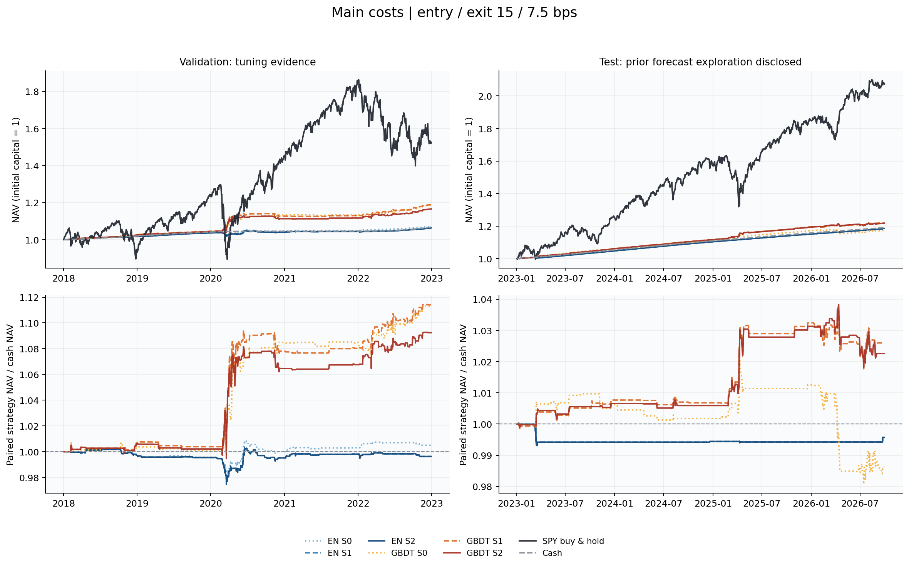
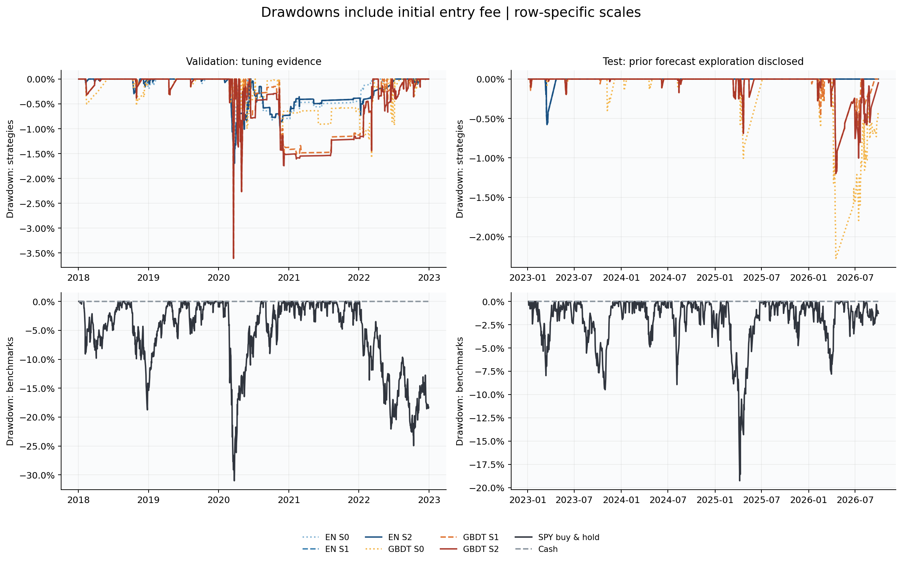
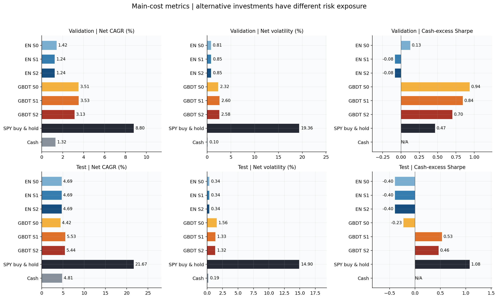
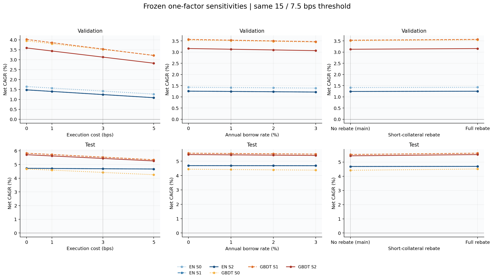
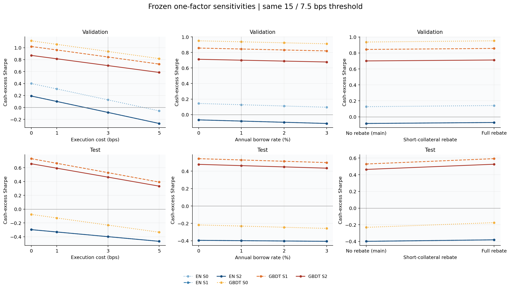
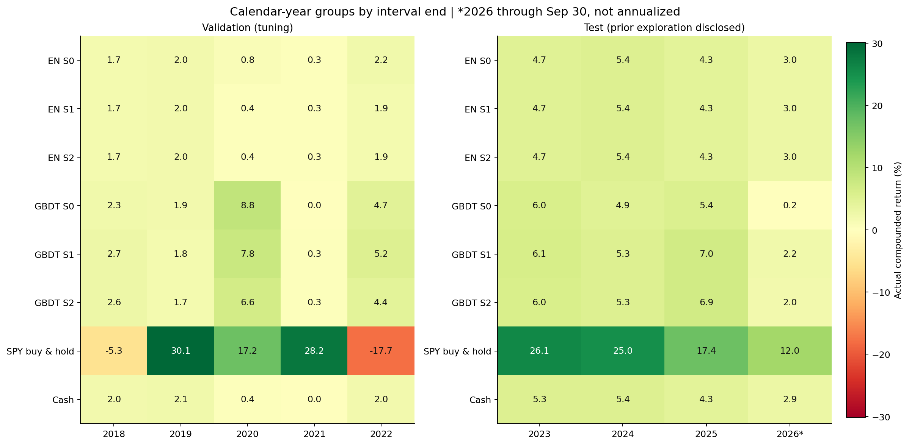

# 第14项：策略指标、比较图与成本/融资敏感性

本项已在第13项1,049项审计通过、协议与输入哈希一致后执行。公共门槛继续为开仓15 bps、退出7.5 bps。原主成本策略与投资基准均复用，不重新拟合模型或选择门槛。

主成本为单边3 bps、借券年化1%、卖空抵押现金不返息。以下全部策略和基准使用同阶段起止开盘，分别从现金1开始，期末清仓。SPY持有固定份额，分红留现金计息。

## 评价与统计口径

验证期2018-01-03至2022-12-30开盘，属于模型与门槛选择后的证据。测试期2023-01-04至2026-09-30开盘；原模型阶段已查看测试预测评价，GBDT也记录探索背景，因此不是从未接触的全盲留出集。

年化净收益按终值与252个交易日计算；波动率使用全部日净收益的样本标准差（ddof=1）乘sqrt(252)；Sharpe使用日净收益减同区间现金收益。最大回撤是带负号的最小净值/历史高点−1，并计入初始资本1和首次开盘费用。双边换手含首尾实际净交易、不除以二。空仓区间保留；现金超额零方差的Sharpe为N/A。

SPY为满仓市场多头，配对策略风险敞口不同；基准用于比较可投资替代品，不能仅凭总收益判定风险调整后的优劣。现金日收益随利率与区间自然日数变化，其净收益波动率可以非零，而现金超额Sharpe仍为N/A。

## 验证期主成本完整指标

| 策略/基准 | 年化净收益 | 年化净波动率 | 现金超额Sharpe | 最大回撤(负值) | 双边年化换手 | 持仓区间比例 | 期末净值 |
|---|---|---|---|---|---|---|---|
| EN S0 | 1.417% | 0.812% | 0.127 | -1.567% | 7.479 | 10.422% | 1.072726 |
| EN S1 | 1.241% | 0.847% | -0.083 | -1.940% | 7.772 | 10.183% | 1.063463 |
| EN S2 | 1.241% | 0.847% | -0.083 | -1.940% | 7.772 | 10.183% | 1.063463 |
| GBDT S0 | 3.511% | 2.317% | 0.937 | -2.327% | 14.059 | 18.059% | 1.187837 |
| GBDT S1 | 3.534% | 2.605% | 0.844 | -3.610% | 15.629 | 17.104% | 1.189139 |
| GBDT S2 | 3.128% | 2.579% | 0.700 | -3.610% | 14.870 | 16.150% | 1.166089 |
| SPY buy & hold | 8.800% | 19.358% | 0.465 | -31.023% | 0.387 | 100.000% | 1.523018 |
| Cash | 1.316% | 0.099% | N/A | 0.000% | 0.000 | 0.000% | 1.067400 |

## 测试期主成本完整指标

| 策略/基准 | 年化净收益 | 年化净波动率 | 现金超额Sharpe | 最大回撤(负值) | 双边年化换手 | 持仓区间比例 | 期末净值 |
|---|---|---|---|---|---|---|---|
| EN S0 | 4.688% | 0.337% | -0.399 | -0.577% | 0.957 | 1.174% | 1.185718 |
| EN S1 | 4.688% | 0.337% | -0.399 | -0.577% | 0.957 | 1.174% | 1.185718 |
| EN S2 | 4.688% | 0.337% | -0.399 | -0.577% | 0.957 | 1.174% | 1.185718 |
| GBDT S0 | 4.420% | 1.558% | -0.231 | -2.275% | 8.013 | 13.767% | 1.174460 |
| GBDT S1 | 5.534% | 1.329% | 0.529 | -1.199% | 9.085 | 13.127% | 1.221736 |
| GBDT S2 | 5.440% | 1.322% | 0.464 | -1.199% | 8.611 | 13.340% | 1.217682 |
| SPY buy & hold | 21.672% | 14.896% | 1.076 | -19.261% | 0.528 | 100.000% | 2.073790 |
| Cash | 4.808% | 0.186% | N/A | 0.000% | 0.000 | 0.000% | 1.190775 |

## 逐年收益

逐年收益按持有区间终止开盘所属年份复利汇总，不将不完整年份年化。首尾年份遵守阶段边界；2026年只截至9月30日。全部72行保存在calendar_year_returns.csv。

## 主成本损益来源

下表均为相对初始资本1的金额百分比，不是各组件分别复利的收益率。终值=1+价格损益+分红+现金利息−借券费−执行费。分红可能为净支出。

### 验证期

| 策略 | 价格损益 | 分红净额 | 现金利息 | 借券费 | 执行费 | 净损益 |
|---|---|---|---|---|---|---|
| EN S0 | 1.846% | -0.030% | 6.685% | 0.068% | 1.160% | 7.273% |
| EN S1 | 0.973% | -0.030% | 6.671% | 0.067% | 1.201% | 6.346% |
| EN S2 | 0.973% | -0.030% | 6.671% | 0.067% | 1.201% | 6.346% |
| GBDT S0 | 14.613% | -0.114% | 6.778% | 0.167% | 2.326% | 18.784% |
| GBDT S1 | 14.754% | 0.132% | 6.809% | 0.180% | 2.601% | 18.914% |
| GBDT S2 | 12.363% | 0.075% | 6.784% | 0.167% | 2.445% | 16.609% |

### 测试期

| 策略 | 价格损益 | 分红净额 | 现金利息 | 借券费 | 执行费 | 净损益 |
|---|---|---|---|---|---|---|
| EN S0 | -0.164% | -0.095% | 18.951% | 0.005% | 0.116% | 18.572% |
| EN S1 | -0.164% | -0.095% | 18.951% | 0.005% | 0.116% | 18.572% |
| EN S2 | -0.164% | -0.095% | 18.951% | 0.005% | 0.116% | 18.572% |
| GBDT S0 | -0.262% | 0.019% | 18.784% | 0.089% | 1.006% | 17.446% |
| GBDT S1 | 4.429% | -0.005% | 18.985% | 0.085% | 1.150% | 22.174% |
| GBDT S2 | 3.962% | -0.005% | 18.985% | 0.082% | 1.092% | 21.768% |

## 预先固定的敏感性场景

每个替代场景分别从现金1回放完整账本，保持同一预测、配对规则、目标权重和15/7.5 bps门槛。费用改变NAV，也会改变以后实际份额、融资及再平衡金额，因此不从固定毛收益曲线直接减费。主设置没有因结果改变。零执行费场景仍有主借券费。

| 场景 | 单边执行费bps | 借券年化 | 全部现金返息 |
|---|---|---|---|
| main | 3 | 1% | 否 |
| execution_0 | 0 | 1% | 否 |
| execution_1 | 1 | 1% | 否 |
| execution_5 | 5 | 1% | 否 |
| borrow_0 | 3 | 0% | 否 |
| borrow_2 | 3 | 2% | 否 |
| borrow_3 | 3 | 3% | 否 |
| full_cash_rebate | 3 | 1% | 是 |

共96行策略/阶段/场景指标，其中12条主成本路径复用，84条替代路径是本次新增执行。SPY/现金主成本比较沿用第12项，不将其另行扩展成未规定的敏感性基准。

以下范围只是固定8个假设的结果范围，不是最优成本或模型选择。全部96行、相对主设置变化与费用细项保存在sensitivity_metrics.csv。

| 阶段 | 策略 | 年化净收益范围 | 现金超额Sharpe范围 |
|---|---|---|---|
| 测试 | EN S0 | 4.668% 至 4.718% | -0.466 至 -0.297 |
| 测试 | EN S1 | 4.668% 至 4.718% | -0.466 至 -0.297 |
| 测试 | EN S2 | 4.668% 至 4.718% | -0.466 至 -0.297 |
| 测试 | GBDT S0 | 4.252% 至 4.671% | -0.334 至 -0.076 |
| 测试 | GBDT S1 | 5.342% 至 5.822% | 0.392 至 0.732 |
| 测试 | GBDT S2 | 5.258% 至 5.712% | 0.333 至 0.658 |
| 验证 | EN S0 | 1.266% 至 1.645% | -0.058 至 0.400 |
| 验证 | EN S1 | 1.084% 至 1.478% | -0.268 至 0.191 |
| 验证 | EN S2 | 1.084% 至 1.478% | -0.268 至 0.191 |
| 验证 | GBDT S0 | 3.221% 至 3.948% | 0.817 至 1.115 |
| 验证 | GBDT S1 | 3.211% 至 4.020% | 0.726 至 1.021 |
| 验证 | GBDT S2 | 2.822% 至 3.589% | 0.586 至 0.871 |

## 比较图

图中保留全部六组策略，三组Elastic Net测试路径相同，曲线会重合。PNG用于查看，SVG用于编辑或导出。

### 主成本净值与六组策略相对现金财富

### 策略及投资基准回撤（上下行分别使用适合的纵轴范围）

### 主成本收益、波动与现金超额Sharpe

### 执行费、借券与返息对年化净收益的影响

### 执行费、借券与返息对现金超额Sharpe的影响

### 逐年实际区间复利收益，2026年为截至9月30日

## 文件与复用

主结果见main_metrics.csv、main_curves.csv、calendar_year_returns.csv及pnl_decomposition.csv；敏感性见sensitivity_metrics.csv、cost_robustness.csv及sensitivity/checkpoints/完整账本。design_config.json记录预先固定口径，numeric_manifest.json记录数值结果，run_manifest.json记录本项整体完成状态。

原始数据、01—04 Notebook、正式模型预测、训练诊断、门槛选择、已登记主策略/基准及审计输出保持不变。本项未执行第15项最终打包或第16项可选扩展。

协议来源：[冻结协议](../phase_evaluation/protocol_config.json)；[公共门槛](../threshold_selection/selected_threshold.json)；[第13项独立审计](../consistency_audit/run_manifest.json)。
