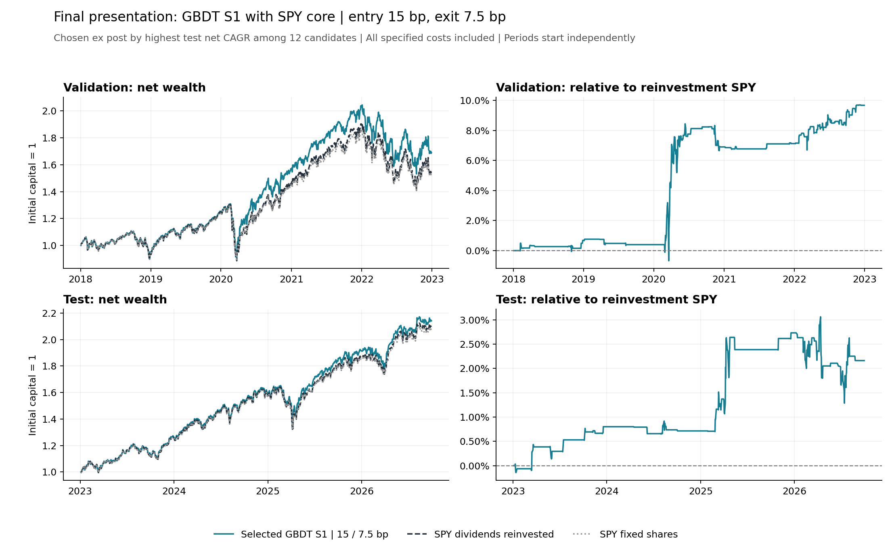

# SPY 增强策略：最终结果与展示选择

最终展示方案为 **GBDT S1，开仓 15 bp／退出 7.5 bp**，使用 100% SPY 基础仓位＋行业—SPY 多空调整。

选择口径按用户最新决定：在已完成的 12 个组合中，以扣除交易费、借券费及融资利息后的测试期净年化收益最高者作为最终展示方案。没有新增参数值、重训模型或重新回放交易。

## 主方案与对照组是什么意思

此前“10／5 bp 主方案”表示重点观察的实验版本；“15／7.5 bp 对照组”表示帮助比较降低门槛影响的固定参照。二者只是实验组织与展示角色，不是优劣评级，也不要求最后一定采用原来的主方案。

现按测试期结果选择最终展示方案，将此前标签保留在历史实验记录中。本报告及 selection_record.json 记录新的展示决定；其他 11 个组合完整保留。

## 测试期主要结果

区间 2023-01-04—2026-09-30，共 937 个持有区间，初始资金归一化为 1。

|指标|最终展示策略|SPY 分红再投入|SPY 固定股数|
|---|---:|---:|---:|
|净年化收益|22.723%|22.019%|21.672%|
|累计净收益|114.119%|109.586%|107.379%|
|年化波动率|15.576%|15.239%|14.896%|
|最大回撤|-19.303%|-19.764%|-19.261%|

相比分红再投入 SPY，最终展示策略的净年化收益高 **0.704 个百分点**，期末财富比高 **2.163%**，年化跟踪误差为 **1.240%**，信息比率为 **0.504**。这两个收益差指标的分母与复利定义不同，不能混用。

## 持仓、换手与成本

- 行业调整参与比例：13.127%；其余时间继续持有 SPY，不再是全部现金。
- 行业平均持有时长：2.135 个开盘到开盘区间；每日检查信号，没有最低持有天数。
- 平均总敞口：102.321%；最大调仓后总敞口：150.000%；平均空头敞口：1.161%。
- 年化双边换手：9.547 倍，包括期初及期末。
- 累计交易费用：初始资金的 1.6907%；借券费：0.0680%；融资利息：0.3538%；合计 2.1125%。这些是整个测试区间累计成本，不是年化费率。

仓位、费用、融资与分红规则完全沿用既有实验：最多四个行业，初始每个行业 ±12.5%；行业空头超 25% 时统一缩放全部行业调整，SPY 权重为 1 减行业净权重。扣费后 NAV 配仓，调仓后总敞口上限 150%。

SPY 先合并净头寸后计算成交，单边交易费 3 bp；空头借券年化 1%，融资利率为当时可得的 DGS3MO＋1 个百分点；空头所得不返息，融资与借券分开按 ACT/365 计提。

## 验证期一并保留

2018-01-03—2022-12-30 独立建账：所选同一组合净年化 11.083%；分红再投入 SPY 为 9.047%。验证期和测试期不拼接成新的独立样本外记录。逐年、行业、持仓段及成本来源见随附 CSV。

## 评价口径

**最终方案是看过测试结果后选出的本次 12 组中收益最高的一组。** 该选择遵照用户本次决定；因此测试收益属于事后选择后的探索性结果，不能称为未参与选择的独立盲测证据，也不据此声称统计显著或未来最优。

## 团队报告可直接采用的结论

> 在本次探索性比较的 12 个 SPY 增强策略组合中，GBDT S1 配合 15／7.5 bp 门槛取得最高的测试期成本后净年化收益，为 22.72%。同期分红再投入 SPY 为 22.02%，对应年化收益增量约 0.70 个百分点，最大回撤为 -19.30%。结果表明该组合在所研究区间取得了有限的成本后增强收益；全部候选组合均保留，最终展示方案依据已观察的测试表现选出。

## 交付文件

- selection_record.json：展示选择、候选范围和证据口径。
- all_12_candidates_ranked.csv：全部候选按测试净年化排序，不隐去较弱结果。
- selected_and_benchmarks.csv：验证、测试两阶段及现金、两种 SPY 基准。
- selected_yearly_returns.csv / selected_sector_contributions.csv / selected_cost_decomposition.csv：已选组合的现有诊断。
- selected_strategy.png / .svg：两阶段独立净值及相对 SPY 表现，可用于报告与展示。
- report_English.md：可用于英文课程报告的简短结果段落。
- 新增 notebook 06：只读取保存结果，不重新训练或交易回放。六个代码单元已在当前 Python 进程内顺序执行并保存输出；原生 Jupyter 内核启动未完成，因此不声称已通过原生内核验证。原 notebook 05 及旧交接文件继续作为历史快照。
