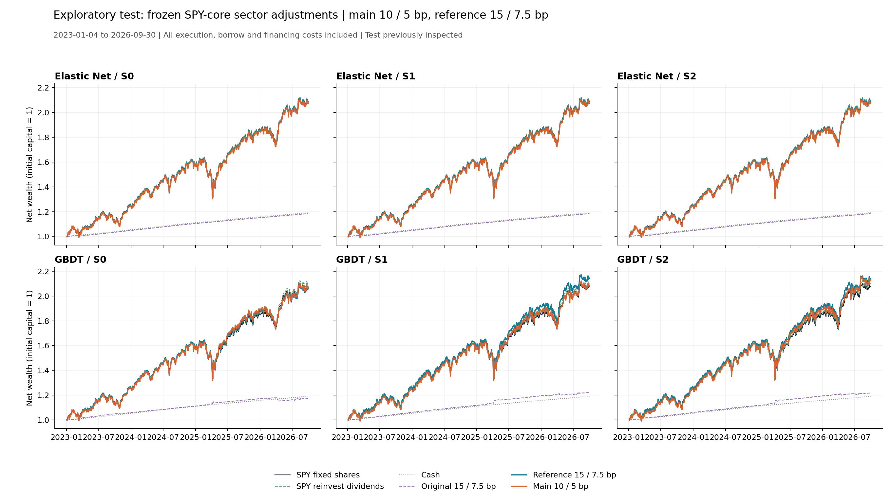

# 第一步：冻结规则的测试期探索性比较

区间：2023-01-04—2026-09-30；10／5 bp 为主方案，15／7.5 bp 为固定参照。六组官方预测全部展示，不根据测试期排名改变门槛或选模型。

交易费仍为单边 3 bp，实际空头借券年化 1%，融资 DGS3MO＋1 个百分点，按 ACT/365。复用验证期原交易引擎，未修改已有代码和结果。

SPY 固定股数买入持有净年化 21.67%，分红再投入 SPY 净年化 22.02%；原 SPY 分红留存现金的基准继续保留。

|组合|净年化|年化波动|最大回撤|相对SPY累计|跟踪误差|信息比率|持有区间均值|行业参与|年化双边换手|平均总敞口|最大总敞口|平均空头|交易费/NAV₀|借券费/NAV₀|融资利息/NAV₀|总成本/NAV₀|
|---|---|---|---|---|---|---|---|---|---|---|---|---|---|---|---|---|
|original_elastic_net_S0|4.69%|0.34%|-0.58%|-42.82%|14.88%|-1.09|1.57|1.17%|0.96|0.29%|25.00%|0.15%|0.12%|0.00%|0.00%|0.12%|
|original_elastic_net_S1|4.69%|0.34%|-0.58%|-42.82%|14.88%|-1.09|1.57|1.17%|0.96|0.29%|25.00%|0.15%|0.12%|0.00%|0.00%|0.12%|
|original_elastic_net_S2|4.69%|0.34%|-0.58%|-42.82%|14.88%|-1.09|1.57|1.17%|0.96|0.29%|25.00%|0.15%|0.12%|0.00%|0.00%|0.12%|
|original_gbdt_S0|4.42%|1.56%|-2.27%|-43.37%|14.79%|-1.11|2.55|13.77%|8.01|3.92%|75.03%|1.96%|1.01%|0.09%|0.00%|1.09%|
|original_gbdt_S1|5.53%|1.33%|-1.20%|-41.09%|14.62%|-1.05|2.14|13.13%|9.09|3.90%|75.01%|1.95%|1.15%|0.08%|0.00%|1.24%|
|original_gbdt_S2|5.44%|1.32%|-1.20%|-41.28%|14.66%|-1.05|2.19|13.34%|8.61|3.79%|75.01%|1.89%|1.09%|0.08%|0.00%|1.17%|
|cash|4.81%|0.19%|0.00%|-42.58%|14.90%|-1.08|—|0.00%|0.00|0.00%|0.00%|0.00%|0.00%|0.00%|0.00%|0.00%|
|spy_buy_hold|21.67%|14.90%|-19.26%|0.00%|0.00%|—|—|0.00%|0.53|97.97%|100.00%|0.00%|0.09%|0.00%|0.00%|0.09%|
|spy_reinvest|22.02%|15.24%|-19.76%|1.06%|0.38%|0.88|—|0.00%|0.55|100.00%|100.00%|0.00%|0.10%|0.00%|0.00%|0.10%|
|overlay_10_elastic_net_S0|21.73%|15.31%|-19.85%|0.17%|0.60%|0.18|1.96|5.44%|4.06|100.67%|125.00%|0.33%|0.66%|0.01%|0.08%|0.75%|
|overlay_10_elastic_net_S1|21.73%|15.31%|-19.85%|0.17%|0.60%|0.18|1.96|5.44%|4.06|100.67%|125.00%|0.33%|0.66%|0.01%|0.08%|0.75%|
|overlay_10_elastic_net_S2|21.73%|15.31%|-19.85%|0.17%|0.60%|0.18|1.96|5.44%|4.06|100.67%|125.00%|0.33%|0.66%|0.01%|0.08%|0.75%|
|overlay_10_gbdt_S0|21.58%|15.44%|-19.18%|-0.29%|1.69%|0.00|2.24|20.81%|14.49|103.18%|150.00%|1.59%|2.50%|0.09%|0.47%|3.07%|
|overlay_10_gbdt_S1|21.85%|15.59%|-19.05%|0.55%|1.68%|0.15|2.05|23.48%|17.84|103.63%|150.00%|1.81%|3.05%|0.10%|0.54%|3.69%|
|overlay_10_gbdt_S2|22.46%|15.60%|-19.05%|2.44%|1.69%|0.45|2.13|23.27%|17.30|104.06%|150.00%|2.03%|3.00%|0.12%|0.63%|3.75%|
|overlay_15_elastic_net_S0|21.88%|15.26%|-19.77%|0.65%|0.47%|0.49|1.57|1.17%|1.50|100.03%|125.00%|0.01%|0.24%|0.00%|0.00%|0.25%|
|overlay_15_elastic_net_S1|21.88%|15.26%|-19.77%|0.65%|0.47%|0.49|1.57|1.17%|1.50|100.03%|125.00%|0.01%|0.24%|0.00%|0.00%|0.25%|
|overlay_15_elastic_net_S2|21.88%|15.26%|-19.77%|0.65%|0.47%|0.49|1.57|1.17%|1.50|100.03%|125.00%|0.01%|0.24%|0.00%|0.00%|0.25%|
|overlay_15_gbdt_S0|21.41%|15.39%|-19.48%|-0.79%|1.49%|-0.09|2.55|13.77%|8.24|102.03%|150.00%|1.01%|1.47%|0.07%|0.34%|1.88%|
|overlay_15_gbdt_S1|22.72%|15.58%|-19.30%|3.25%|1.40%|0.69|2.14|13.13%|9.55|102.32%|150.00%|1.16%|1.69%|0.07%|0.35%|2.11%|
|overlay_15_gbdt_S2|22.62%|15.53%|-19.30%|2.92%|1.38%|0.63|2.19|13.34%|9.13|102.29%|150.00%|1.15%|1.62%|0.07%|0.36%|2.05%|

成本列为整个区间累计实际金额/初始资金，年化换手为双边倍数/年。行业参与不含 SPY 基础仓位；平均持有时长按行业、方向的连续持仓段统计。完整 CSV 另外提供相对分红再投入 SPY 的累计表现、跟踪误差与信息比率。

主方案超过固定股数 SPY 的组合数：5/6；超过分红再投入 SPY：1/6。

10 bp 相比 15 bp 净年化改善：1/6。这是固定方案比较，不据此事后选最优门槛。

## 与验证期并列观察

|组合|验证15净年化|验证10净年化|测试15净年化|测试10净年化|
|---|---:|---:|---:|---:|
|elastic_net/S0|9.14%|7.89%|21.88%|21.73%|
|elastic_net/S1|8.94%|8.10%|21.88%|21.73%|
|elastic_net/S2|8.94%|8.10%|21.88%|21.73%|
|gbdt/S0|11.25%|10.85%|21.41%|21.58%|
|gbdt/S1|11.08%|11.43%|22.72%|21.85%|
|gbdt/S2|10.68%|10.87%|22.62%|22.46%|

测试期的预测、旧策略结果此前已被查看；本次为探索性复用，不是全新盲测。验证期和测试期独立初始化，2026 年仅到 9 月 30 日。

下一步只做年份、行业、持仓段与成本来源诊断；任何规则调整需另列为新实验，不能再把当前测试期当作未使用的验证证据。
