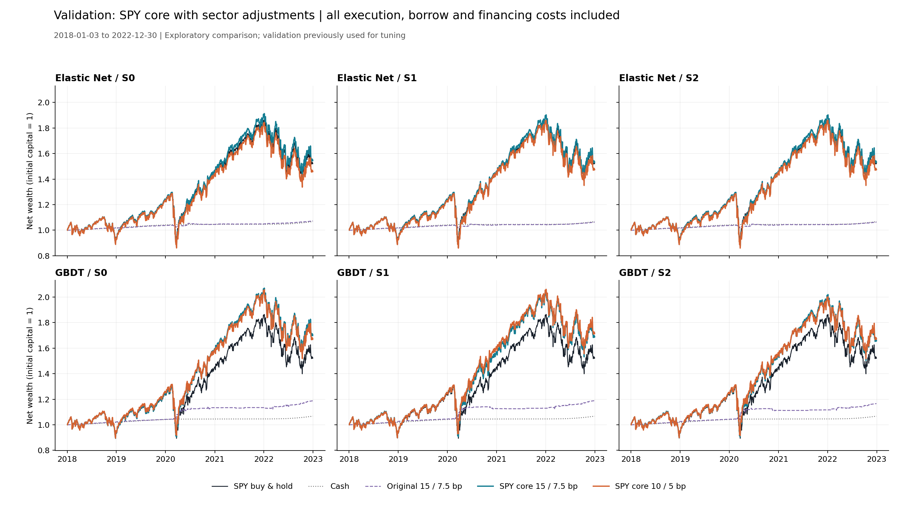

# SPY 基础持仓＋行业调整：验证期探索性实验

验证期：2018-01-03 至 2022-12-30；每组 1,257 个开盘到开盘持有区间。原始结果保留，测试期未运行。

复用六组官方预测及原排序、保留、退出和反向规则；主成本：单边 3 bp、借券年化 1%、融资 DGS3MO＋1 个百分点。

新策略每天按扣费后 NAV 恢复目标权重，保证调仓后实际总敞口不超过 150%。原策略参照保留其原有扣费前 NAV 配仓口径。

|组合|净年化|年化波动|最大回撤|相对SPY累计|跟踪误差|信息比率|持有区间均值|行业参与|年化双边换手|平均总敞口|最大总敞口|平均空头|交易费/NAV₀|借券费/NAV₀|融资利息/NAV₀|总成本/NAV₀|
|---|---|---|---|---|---|---|---|---|---|---|---|---|---|---|---|---|
|original_elastic_net_S0|1.42%|0.81%|-1.57%|-29.57%|19.27%|-0.46|1.78|10.42%|7.48|2.63%|50.00%|1.31%|1.16%|0.07%|0.00%|1.23%|
|original_elastic_net_S1|1.24%|0.85%|-1.94%|-30.17%|19.25%|-0.47|1.68|10.18%|7.77|2.57%|50.00%|1.28%|1.20%|0.07%|0.00%|1.27%|
|original_elastic_net_S2|1.24%|0.85%|-1.94%|-30.17%|19.25%|-0.47|1.68|10.18%|7.77|2.57%|50.00%|1.28%|1.20%|0.07%|0.00%|1.27%|
|original_gbdt_S0|3.51%|2.32%|-2.33%|-22.01%|19.32%|-0.35|2.40|18.06%|14.06|5.99%|75.02%|2.99%|2.33%|0.17%|0.00%|2.49%|
|original_gbdt_S1|3.53%|2.60%|-3.61%|-21.92%|19.37%|-0.35|2.23|17.10%|15.63|6.33%|100.02%|3.16%|2.60%|0.18%|0.00%|2.78%|
|original_gbdt_S2|3.13%|2.58%|-3.61%|-23.44%|19.40%|-0.37|2.23|16.15%|14.87|5.91%|75.02%|2.95%|2.45%|0.17%|0.00%|2.61%|
|cash|1.32%|0.10%|0.00%|-29.92%|19.36%|-0.47|—|0.00%|0.00|0.00%|0.00%|0.00%|0.00%|0.00%|0.00%|0.00%|
|spy_buy_hold|8.80%|19.36%|-31.02%|0.00%|0.00%|—|—|0.00%|0.39|96.56%|100.00%|0.00%|0.07%|0.00%|0.00%|0.07%|
|overlay_15_elastic_net_S0|9.14%|20.28%|-32.92%|1.55%|1.26%|0.39|1.78|10.42%|7.85|101.37%|150.00%|0.69%|1.46%|0.05%|0.09%|1.59%|
|overlay_15_elastic_net_S1|8.94%|20.31%|-33.19%|0.65%|1.31%|0.25|1.68|10.18%|8.15|101.27%|150.00%|0.64%|1.51%|0.04%|0.08%|1.63%|
|overlay_15_elastic_net_S2|8.94%|20.31%|-33.19%|0.65%|1.31%|0.25|1.68|10.18%|8.15|101.27%|150.00%|0.64%|1.51%|0.04%|0.08%|1.63%|
|overlay_15_gbdt_S0|11.25%|20.45%|-30.70%|11.76%|2.48%|0.99|2.40|18.06%|14.22|104.10%|150.00%|2.05%|3.03%|0.14%|0.34%|3.51%|
|overlay_15_gbdt_S1|11.08%|20.47%|-30.69%|10.91%|2.71%|0.85|2.23|17.10%|15.45|103.94%|150.00%|1.97%|3.25%|0.14%|0.29%|3.68%|
|overlay_15_gbdt_S2|10.68%|20.44%|-30.69%|8.90%|2.67%|0.72|2.23|16.15%|14.86|103.64%|150.00%|1.82%|3.08%|0.13%|0.25%|3.45%|
|overlay_10_elastic_net_S0|7.89%|20.32%|-33.13%|-4.11%|1.56%|-0.42|2.04|28.96%|18.42|104.20%|150.00%|2.10%|3.48%|0.14%|0.28%|3.89%|
|overlay_10_elastic_net_S1|8.10%|20.31%|-33.14%|-3.15%|1.53%|-0.29|1.95|28.56%|19.02|104.14%|150.00%|2.07%|3.59%|0.14%|0.28%|4.01%|
|overlay_10_elastic_net_S2|8.10%|20.31%|-33.14%|-3.15%|1.53%|-0.29|1.95|28.56%|19.02|104.14%|150.00%|2.07%|3.59%|0.14%|0.28%|4.01%|
|overlay_10_gbdt_S0|10.85%|20.56%|-30.35%|9.76%|2.79%|0.76|2.20|29.28%|26.14|107.20%|150.00%|3.60%|5.70%|0.25%|0.57%|6.53%|
|overlay_10_gbdt_S1|11.43%|20.58%|-29.13%|12.67%|3.08%|0.86|2.23|31.74%|26.18|107.52%|150.00%|3.76%|5.67%|0.27%|0.68%|6.61%|
|overlay_10_gbdt_S2|10.87%|20.53%|-30.33%|9.83%|3.01%|0.70|2.26|30.39%|24.46|107.06%|150.00%|3.53%|5.19%|0.25%|0.63%|6.07%|

年化换手为双边倍数/年，含期初与期末；成本为累计实际金额除以初始资金。初始资金设为 1，若按 100 万元展示，成本列乘以 100 万即可。

持有区间均值按每个行业连续同方向持仓段计算，调仓数量变化不重置；行业参与只计算行业调整，不包含基础 SPY。

相对 SPY 累计表现采用期末财富比减一；信息比率基于逐日净收益差，不用年化复合收益差代替。

SPY 买入持有为固定股数、分红留存现金并在后续区间计息；新策略因每日再平衡会将分红重新投入目标组合。两者均计入进出成本。

验证期已用于既有模型和门槛调整，本次结果仍属于探索性验证期分析。利率沿用原数据的假设公布时间，不代表重新构建的实时历史版本。

本轮新增策略 12 组；净年化收益高于 SPY 的组合数：9。

10／5 bp 相比 15／7.5 bp，净年化收益改善的组合数：2/6。逐对变化详见 threshold_paired_comparison.csv。

- elastic_net/S0：净年化 9.14% → 7.89%；行业参与 10.42% → 28.96%；平均持有 1.78 → 2.04 个区间；年化双边换手 7.85 → 18.42 倍；总成本/初始资金 1.59% → 3.89%。
- elastic_net/S1：净年化 8.94% → 8.10%；行业参与 10.18% → 28.56%；平均持有 1.68 → 1.95 个区间；年化双边换手 8.15 → 19.02 倍；总成本/初始资金 1.63% → 4.01%。
- elastic_net/S2：净年化 8.94% → 8.10%；行业参与 10.18% → 28.56%；平均持有 1.68 → 1.95 个区间；年化双边换手 8.15 → 19.02 倍；总成本/初始资金 1.63% → 4.01%。
- gbdt/S0：净年化 11.25% → 10.85%；行业参与 18.06% → 29.28%；平均持有 2.40 → 2.20 个区间；年化双边换手 14.22 → 26.14 倍；总成本/初始资金 3.51% → 6.53%。
- gbdt/S1：净年化 11.08% → 11.43%；行业参与 17.10% → 31.74%；平均持有 2.23 → 2.23 个区间；年化双边换手 15.45 → 26.18 倍；总成本/初始资金 3.68% → 6.61%。
- gbdt/S2：净年化 10.68% → 10.87%；行业参与 16.15% → 30.39%；平均持有 2.23 → 2.26 个区间；年化双边换手 14.86 → 24.46 倍；总成本/初始资金 3.45% → 6.07%。
